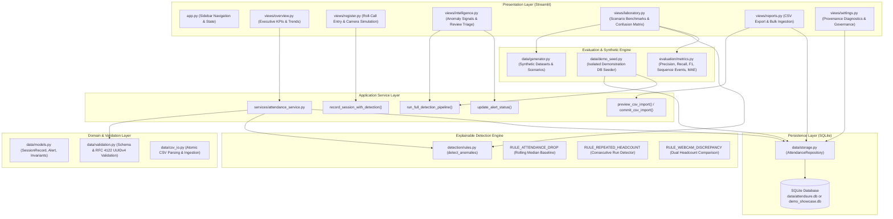

# AttendSure System Architecture Overview

This document describes the production architecture, module boundaries, data flows, and design patterns implemented in **AttendSure**, an explainable attendance integrity and anomaly detection platform for rural schools.

---

## 1. Architectural Philosophy

AttendSure is engineered according to five foundational principles:

1. **Offline-First Resilience**: Designed for rural educational settings with intermittent or absent internet connectivity. Core operations require zero external API calls or cloud dependencies.
2. **Transparent Explainability**: Every anomaly detector provides a plain-language explanation, observable metrics, a rolling baseline reference, and the applied mathematical threshold.
3. **Strict Privacy by Design**: All attendance data is aggregated at the classroom cohort level. No student biometric templates, facial recognition models, or individual names/IDs are collected or processed.
4. **Layered Separation of Concerns**: Strict boundaries between UI presentation, domain services, data validation, detection logic, and persistence.
5. **Data Contract Compliance**: All data structures strictly conform to [`docs/data-contract.md`](data-contract.md).

---

## 2. Component Architecture & Data Flow

---

## 3. Subsystem Breakdown

### 3.1 Presentation Layer (`src/attendsure/ui/`)
- **`app.py`**: Main application router. Initializes session state, manages database connection contexts, injects shared styling, and renders sidebar navigation.
- **`styles.py`**: Design system tokens adhering to administrative light-first standards, high-contrast typography, and accessible status badges.
- **`state.py`**: Centralized connection lifecycle manager. Determines database path via `st.session_state` override, `ATTENDSURE_DB_PATH` environment variable, or default canonical path.
- **Views**:
  - `overview.py`: Executive metrics, cohort attendance trends, and recent high-priority alerts.
  - `register.py`: Daily roll-call entry form, simulated webcam validation, and historical register table.
  - `intelligence.py`: Anomaly review queue, multi-criteria filtering, structured explanation inspection, and triage state management (`PENDING_REVIEW` -> `ACKNOWLEDGED` / `RESOLVED` / `DISMISSED`).
  - `laboratory.py`: Offline algorithm sandbox. Runs synthetic scenarios and calculates live classification metrics without writing to SQLite.
  - `reports.py`: CSV audit exports and atomic bulk upload interface.
  - `settings.py`: Storage diagnostic checks, provenance source breakdowns (`MANUAL_ENTRY`, `CSV_IMPORT`, `SYNTHETIC`), and data governance policies.

### 3.2 Service Layer (`src/attendsure/services/`)
- **`attendance_service.py`**: Coordinates multi-step transactional workflows:
  - `record_session_with_detection()`: Validates manual entry, checks historical baseline, runs detection, and atomically persists session and new alerts.
  - `run_full_detection_pipeline()`: Scans stored historical sessions across cohorts while preserving educator review decisions via repository conflict safeguards.
  - `preview_csv_import()` / `commit_csv_import()`: Provides preview isolation (0 writes) and all-or-nothing transaction rollback.

### 3.3 Domain and Validation Layer (`src/attendsure/data/`)
- **`models.py`**: Immutable domain dataclasses (`SessionRecord`, `Alert`, `ValidationResult`, `WebcamCounterResult`).
- **`validation.py`**: Strict schema contract enforcer:
  - Validates RFC 4122 UUIDv4 identifiers.
  - Enforces cohort count invariant: `present_count + absent_count == expected_enrollment`.
  - Validates date ranges and ISO 8601 UTC timestamps.
- **`csv_io.py`**: CSV reader/writer supporting both all-or-nothing and partial import modes with row-level error reporting.

### 3.4 Detection Engine (`src/attendsure/detection/`)
- **`rules.py`**: Pure, deterministic detection logic:
  - **`RULE_ATTENDANCE_DROP`**: Flags attendance rate drops exceeding 25 percentage points below the cohort's historical rolling median.
  - **`RULE_REPEATED_HEADCOUNT`**: Identifies suspicious runs where identical headcount numbers are reported for 4 or more consecutive school days.
  - **`RULE_WEBCAM_DISCREPANCY`**: Compares manual roll-call headcount with simulated optical headcount, flagging differences >= 5 students and >= 20%.

### 3.5 Evaluation & Benchmarking (`src/attendsure/evaluation/`)
- **`metrics.py`**: Mathematical evaluation engine:
  - Classification metrics: Precision, Recall, F1-Score, and Confusion Matrix.
  - Sequence-event vs session-level evaluation accounting.
  - Simulated camera accuracy metrics: Mean Absolute Error (MAE) and Mean Absolute Percentage Error (MAPE) with zero-denominator safety.

### 3.6 Persistence Layer (`src/attendsure/data/storage.py`)
- **`AttendanceRepository`**: Encapsulates SQLite database operations:
  - Automatic schema and index creation (`attendance_sessions`, `alerts`).
  - Foreign key enforcement and atomic transactions.
  - Conflict-aware alert persistence that prevents overwriting educator review triage decisions.
