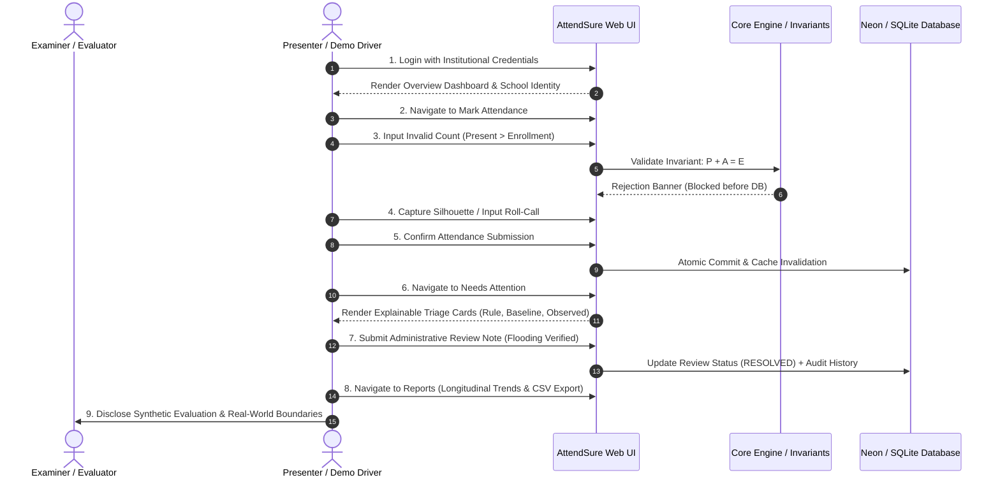

# Live Academic Demonstration Guide & Script (5–7 Minutes)

**Official Project Title:** Rural School Attendance Integrity and Intervention Decision System  
**Repository:** https://github.com/ashishkumartripathi/AttendSure  
**Branch:** `feature/modern-saas-ui`  
**Presenters:** Ashish Kumar Tripathi & Harsh Jakhar  
**Faculty Evaluator / Mentor:** Mr. Hitesh Jangid  

---

## 1. Demonstration Protocol Overview

This document provides a timed, step-by-step presentation script designed for a 5–7 minute live technical evaluation before academic examiners. It demonstrates all functional modules, invariant validation, explainable anomaly detection, administrative human review, and longitudinal analytics.

### Live Architecture Environment
- **Primary Live Mode:** Public Streamlit Cloud deployment connected to Neon PostgreSQL in AWS Singapore (`aws-ap-southeast-1`).
- **Offline Fallback Mode:** Local Python 3.13 Streamlit instance backed by an embedded SQLite database (`data/attendsure.db`), requiring **zero internet connectivity**.

---

## 2. Timed Demonstration Walkthrough (5–7 Minutes)



---

### Step 1: Institutional Login & Role Gating (0:00 – 0:45)
- **Action:** Open application URL or localhost port `8501`.
- **Spoken Commentary:**
  > "We begin at the institutional login gate. AttendSure implements role-based access control protecting rural school data without storing plaintext credentials. Passwords are cryptographically hashed using PBKDF2 with HMAC-SHA256 and 100,000 iterations.
  > We will first sign in as the School Headmaster (`headmaster` / `Admin@SIH2025!`). Notice that the session immediately binds to our institutional context: *Rajkiya Uchha Madhyamik Vidyalaya* (School Code: `RUMV-081204`)."
- **Visual Highlight:** Point to the school tenant banner and user role tag in the top navigation.

---

### Step 2: Overview Dashboard & Progressive Disclosure (0:45 – 1:30)
- **Action:** Point out the 5 core KPI cards: Total Enrollment, Present Today, Absent Today, Today's Attendance Rate, and Needs Attention.
- **Spoken Commentary:**
  > "The Overview screen follows the Progressive Disclosure principle: Simple by default, powerful when needed.
  > At Level 1, headmasters and teachers see plain-English metrics for today's active session.
  > If no session has been recorded yet today, the system displays a clear info banner rather than confusing historical sums or zero divisions.
  > Below the cards, the Daily Attendance Trend chart plots historical attendance percentages across cohorts."
- **Visual Highlight:** Point out the *Active Today* badges and clean KPI cards.

---

### Step 3: Mark Attendance & Invariant Rejection (1:30 – 2:45)
- **Action 3A (Negative Test):** Select `CLASS-01-A`, set Enrollment = 30, and enter Present Count = 35. Click **Submit Attendance Session**.
- **Spoken Commentary:**
  > "Before demonstrating normal recording, let us test system resilience. AttendSure strictly enforces the mathematical count invariant:
  > $$\text{Present} + \text{Absent} = \text{Enrollment}, \quad 0 \le \text{Present} \le \text{Enrollment}$$
  > If an educator accidentally enters a present count of 35 against an enrollment of 30, the application instantly flags an error banner and aborts the transaction before touching the database."
- **Action 3B (Positive Test with Assistive Camera):** Correct counts to $E=30, P=28, A=2$. Click **Capture Silhouette**.
- **Spoken Commentary:**
  > "Next, notice our assistive camera component. It uses non-biometric silhouette contour segmentation—no facial recognition, no biometric embeddings, and zero disk image retention.
  > The camera returns an advisory estimate (e.g., 28 students). In accordance with our human-in-the-loop philosophy, the camera is an aid, never an autonomous decision-maker. The teacher reviews the count, adjusts if necessary, and confirms submission."
- **Visual Highlight:** Green success notification: *Attendance session recorded successfully*.

---

### Step 4: Attendance Records & Search Filters (2:45 – 3:30)
- **Action:** Click **Attendance Records** on the sidebar. Filter by cohort (`CLASS-01-A`) and search date.
- **Spoken Commentary:**
  > "The Attendance Records screen provides historical audit logs. Every record tracks data provenance via the `record_source` column (`MANUAL_ENTRY`, `CSV_IMPORT`, or `SYNTHETIC`), ensuring synthetic test data is never confused with operational records."
- **Visual Highlight:** Point out pagination and cohort selector responding in ~158 ms.

---

### Step 5: Explainable Anomaly Detection & Triage Cards (3:30 – 4:30)
- **Action:** Click **Needs Attention**. Expand an active alert card.
- **Spoken Commentary:**
  > "This is our core intelligence module. AttendSure rejects opaque black-box classifiers. Every alert follows a strict explainability contract containing 5 explicit fields:
  > 1. **Rule Identifier:** e.g., `RULE_ATTENDANCE_DROP` or `RULE_REPEATED_HEADCOUNT`.
  > 2. **Observed Value:** e.g., Present Count = 9 ($E=25$).
  > 3. **Rolling Baseline:** Historical median of 21.0 students over the previous 5 sessions.
  > 4. **Threshold Applied:** Drop $> 30\%$ below median.
  > 5. **Plain-English Rationale:** Explaining why the pattern warrants administrative inspection."
- **Visual Highlight:** Show the structured Markdown/HTML evidence card with the comparison table.

---

### Step 6: Human-in-the-Loop Review Lifecycle (4:30 – 5:30)
- **Action:** In the alert review form, select radio button **RESOLVED**, enter note: *"Heavy localized rain caused river overflow; verified with village sarpanch."*, and click **Update Alert Status**.
- **Spoken Commentary:**
  > "Crucially, AttendSure operates under the doctrine of **Decision Support, Never Accusation**. In rural schools, attendance drops usually indicate agricultural harvesting, monsoon flooding, or seasonal illness—not fraud.
  > The headmaster can transition the alert through a formal state machine: `ACKNOWLEDGED`, `RESOLVED`, or `DISMISSED`.
  > When resolved, the note is permanently appended to the immutable audit trail."
- **Visual Highlight:** Status badge updates from `PENDING_REVIEW` to `RESOLVED` with timestamp and reviewer identity.

---

### Step 7: Longitudinal Reports & CSV Export (5:30 – 6:15)
- **Action:** Navigate to **Reports**. Click **Download Session CSV**.
- **Spoken Commentary:**
  > "The Reports view computes longitudinal trends, monthly cohort attendance rankings, and data exports. Headmasters can export sanitized, standards-compliant CSV summaries for block educational officers (BEO) or state portal reporting."
- **Visual Highlight:** Instant CSV download in browser.

---

### Step 8: Synthetic Evaluation & Honest Limitations (6:15 – 7:00)
- **Action:** Navigate to **Settings** or open presentation summary slide.
- **Spoken Commentary:**
  > "To conclude, we emphasize our verified scientific boundaries:
  > - **Automated Test Suite:** 414 automated tests pass with 100% success in 87 seconds.
  > - **Synthetic vs. Field Reality:** Our camera estimator achieves 0.14 MAE on synthetic silhouettes. We explicitly disclose that this does not constitute real-world classroom accuracy, where lighting and occlusion vary widely.
  > - **Hardware Boundary:** No physical RFID scanner hardware is claimed; the system provides a clean software abstraction for future hardware integration.
  > - **Privacy-First:** AttendSure proves that school attendance integrity can be safeguarded affordably and ethically without compromising child privacy."

---

## 3. Emergency Fallback Plan (Contingency Procedures)

In the event of network disruption, cloud provider downtime, or physical projector failures during evaluation, execute the following fallback procedures:

### Fallback Level 1: Cloud Network Failure $\to$ Local Offline Execution
If Streamlit Community Cloud or the Singapore Neon PostgreSQL connection times out:
```bash
# 1. Open local terminal in repository root
cd AttendSure

# 2. Run local Streamlit app in Offline SQLite mode
streamlit run src/attendsure/ui/app.py
```
- **Operational Reality:** The local application automatically detects the absence of `DATABASE_URL`, initializes local SQLite (`data/attendsure.db`), and runs completely offline with identical features.

### Fallback Level 2: Browser Video / Screenshot Walkthrough
If the host evaluation machine experiences display or runtime errors:
- Open `submission/screenshots/` containing 12 high-resolution screenshots capturing every screen, dialog, and validation state.
- Walk the examiners through the slides in `submission/presentation/Rural_School_Attendance_System_Presentation.pptx`.

### Fallback Level 3: Terminal Benchmark Verification
Examiners wishing to verify algorithm claims directly without GUI:
```bash
# Run the complete test suite (414 tests)
pytest

# Run the benchmark reproduction script
python scripts/reproduce_benchmarks.py
```
